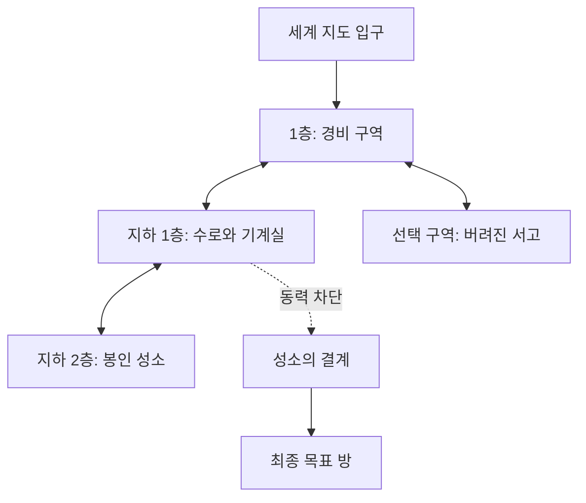

# 던전 v2 확장 설계안

상태: **검토용 설계. 이번 작업에서 v2 기능 구현이나 신규 이미지 생성은 하지 않았다.** GitHub `d4606c3e`를 검토 기준으로 기존 단층 던전 위에 적용할 변경과 제작 가이드를 정리한다. 공용 지저·해저 에셋 24종은 이미 존재하며 재사용 검토 대상이다.

목표는 층별 컨셉과 규모를 정하고, 개별 에셋을 배치하며, 함정·결계·퍼즐과 층간 이동을 편집할 수 있는 던전 제작/운영 도구다. 신규 생성, 선택 범위 재생성, 기존 던전에 추가 생성을 각각 제공한다.

## 1. 현재 기능과 필요한 변경

| 영역 | 현재 코드에서 확인한 상태 | v2 설계 |
| --- | --- | --- |
| 지도 구조 | `DungeonInterior.version: 1`, 바닥 격자/방/배치물 한 묶음 | 여러 `Floor`와 독립된 층간 연결 목록 |
| 컨셉 | 17개 거점 테마. 자동 생성 거점의 내부 테마/대표 몬스터 선택은 고정 | 거점의 기본 테마를 상속하되 층별 컨셉·구조·주민을 덮어쓰기 |
| 생성/재생성 | 시드 기반 단층 생성, 전체 내부 재생성, 난이도 변경 | 신규 던전 / 층·방·배치만 재생성 / 층·구역 추가 |
| 함정 | `darts`, `rune`, `pit` 3종 | 물리·마법 함정 템플릿과 발동·감지·해제·초기화 상태 |
| 기믹 | `alarm`, `ward`, `flood` 3종. 주로 GM용 설명/표식 | 연결된 장치와 조건을 저장하고 GM이 발동·라운드 진행을 조작 |
| 지도 에셋 | 던전은 `paving` PNG를 바닥 패턴으로 사용. 적·함정·상자·기믹은 단순 SVG 표식 | 전용 PNG 부품 + 독립된 점유/통행/시야 데이터 |
| 필수 경로 | 단층 바닥 BFS, 비밀방을 제외해도 일반 방에 도달, 보스 1개 필수 | 층간 경로와 잠금 해제 선행 조건까지 검증. 층마다 보스를 강제하지 않음 |
| 표시/출력 | GM/플레이어 보기, 전체도/방 전투지도, PNG/SVG | 층 선택·단면도, 공개 상태를 반영한 층별/일괄 출력 |
| 저장 | `Marker.interior`가 표식 JSON에 들어가 `.map`/FPB/복구에 저장 | v1 읽기와 v2 읽기/쓰기를 함께 지원 |

조사한 코드: [타입](../../src/types/dungeon-interior.ts), [생성기](../../src/generators/dungeon-interior.ts), [검증기](../../src/data/dungeon-validation.ts), [편집창](../../src/controllers/dungeon-interior.ts), [렌더러](../../src/renderers/dungeon-interior.ts), [기존 설계](./dungeon-interior.design.md).

현재 난이도 전환은 같은 지형 시드에 전투·함정·보상을 다시 구성한다. 새 층/장치 개념을 현재 재생성 버튼에 모두 섞지 않는다. 기존 규칙에서 변경되는 부분을 명시한 버전별 생성기를 사용한다.

## 2. 제작 화면과 컨셉 설정

왼쪽에 층 목록, 가운데에 현재 층 지도, 오른쪽에 선택한 방/장치 속성을 둔다. 상단에서는 던전 설정·생성 작업·GM/플레이어 보기·내보내기를 선택한다. 모바일에서는 층 목록/지도/속성을 탭으로 나눠 한 번에 하나를 편집한다.

- **전체 기본값:** 이름, 시드, 기본 컨셉, 환경(건조/침수/용암 등), 주민/몬스터 테마, 난이도, 기믹 밀도, 목표/최종 구역.
- **층별 덮어쓰기:** 이름·층 표기·고도/깊이·규모·방 수·구조(요새/동굴/미로/탑/묘역 등)·재질·기믹 묶음·주민·조명·GM 메모.
- 컨셉은 기존 프리셋 + 사용자 조합으로 만든다. 자유 입력한 이름과 설명은 보존하되 문장만으로 통로/규칙이 자동 해석된다고 가정하지 않는다. 생성에 영향을 주는 구조/환경/기믹 선택을 별도로 보여 준다.
- 대표 몬스터를 바꾸지 않고 건축/환경만 바꿀 수 있다. 기존 17개 거점 테마와 건축 양식을 같은 선택지로 묶지 않는다.
- 새 층의 설정은 기본값을 상속한 뒤 층별 차이만 표시한다. 기존 층에 기본값 변경을 소급할지는 사용자가 대상 층을 선택한다.
- 던전 **전체 기본**, **층 지형**, **방 전투지도 출력** 설정을 구분한다. 미적용 값은 초안으로 보존하고 실제 생성/적용 전에 기존 지도를 바꾸지 않는다.

전체 층 수를 직접 입력하고 1/3/5/10층 빠른 선택을 제공한다. 초기 운영 권장은 1~20층이다. 기술 제한안은 던전당 최대 100층, 생성된 층의 합계 262,144셀, 층당 방 200개/장치 1000개다. **이 숫자는 성능 실측 전 제안이며 확정된 사용자 요구가 아니다.** 허용 예산/예상 크기를 먼저 계산하고 초과 요청은 기존 던전을 보존한 채 안내한다. 층 수만 보고 모든 층을 동시에 DOM에 그리지 않는다.

## 3. 신규·재생성·추가 생성의 동작

| 작업 | 대상과 결과 | 기본 보존 범위 |
| --- | --- | --- |
| 신규 던전 생성 | 선택한 새 거점에 새 던전 ID/시드로 층과 연결 생성 | 다른 던전과 세계 지도 유지 |
| 복제해서 새 던전 | 기존 던전 복사 후 새 던전 ID 부여, 내부 참조 일괄 재매핑 | 원본 유지. 진행 상태는 기본 초기화, 포함 여부 선택 |
| 선택 층 지형 재생성 | 해당 층 방/통로를 새로 구성 | 다른 층, 층간 연결의 보호된 접속 구역, 잠긴 구역 |
| 선택 방/구역 재생성 | 지정 경계 안의 지형을 교체 | 방 ID, 경계 출입구, 외부 참조, 보호 구역 |
| 배치만 재생성 | 적/보상/장식/장치 중 선택 항목 재배치 | 바닥/벽/방/층간 통로, 수동/잠긴 항목 |
| 층 추가 | 위/아래/선택 층 사이 또는 분기 구간에 새 층 삽입 | 기존 층 ID/좌표/진행 상태 유지 |
| 현재 층 구역 추가 | 지정한 빈 영역/외곽을 생성해 기존 접속구에 연결 | 기존 방과 배치 유지. 재구획/늘이기 없음 |
| 전체 재생성 | 명시적으로 선택한 전체 범위 교체 | 잠긴 층·항목은 기본 제외. 제외 후에도 경로 검증 |
| 층 축소/삭제 | 선택한 층 제거와 연결 정리 | 삭제·재연결 대상을 미리 보여 준 뒤 적용 |

작업은 **초안 생성 → 영향 미리보기 → 검증 → 적용**으로 처리한다. 미리보기에는 새/변경/삭제되는 층·방·장치와 보존하지 못하는 참조를 보여 준다. 적용 전에는 현재 지도를 유지하며 취소할 수 있다. 실패/취소는 기존 지도와 난수 상태를 바꾸지 않는다.

신규/복제는 새 세계 거점을 배치하거나 내부 기록이 없는 거점에 연결한다. 한 `Marker.interior`에는 던전 하나를 저장한다. 같은 거점의 현재 던전을 바꾸는 것은 신규 생성으로 포장하지 않고 교체/전체 재생성으로 표시한다.

층 수를 줄이는 입력을 곧바로 삭제로 처리하지 않는다. 제거할 층과 끊기는 통로/퍼즐/퀘스트 연결을 선택하고, 재연결하거나 중단한다. 추가 생성에서 통로가 들어갈 공간이 없으면 자동으로 기존 방을 밀지 말고 위치 선택/확장 방향을 제시한다.

`locked`는 지형/방/장치/층에서 설정한다. 수동 편집 여부(`edited`)와 생성 출처(`origin`)를 기록한다. 재생성 기본은 수동/잠김 항목 보존이며, 편집 중인 초안도 영향 범위 검사에 포함한다. 층 잠금과 세계 거점의 `marker.lock`은 별개로 유지한다.

## 4. 다층 구조와 연결 규칙

층 배열 순서와 층의 영구 ID를 분리한다. `B2`, `B1`, `1F`, `중간층`은 표시 이름일 뿐 식별자로 사용하지 않는다. 재정렬·층 삽입으로 다른 층의 시드/방 ID를 바꾸지 않는다.

층간 높이는 `elevationFt`로 별도 저장한다. 기본 층 간격 15ft를 제안하되 직접 수정 가능하며, 목록 순서에서 낙하 거리를 계산하지 않는다. 깊이(m)로 표시하는 세계 공간과 연결할 때는 단위와 기준점을 명시해 환산한다. 그리드 한 칸은 기존 5ft를 기본으로 유지한다.

연결은 출발/도착의 `floorId + endpointId`를 참조한다. 각 endpoint는 방 ID·현지 격자 좌표·진입 방향·점유 크기를 가진다.

| 연결 | 기본 규칙 |
| --- | --- |
| 계단·사다리 | 일반적으로 왕복. 선택 시 목적 층과 도착 접속구를 강조 |
| 승강기·수직갱 | 여러 정차 층/동력·조작 조건을 연결. 초기에는 2개 층부터 지원 |
| 낙하 구덩이 | 단방향 가능. 착지 구역·높이 차이·탈출 경로 표시 |
| 포털 | 비인접 층 연결 가능. 물리적으로 같은 x/y일 필요 없음 |
| 침수 수직 통로 | 수영/침수 통로 태그. 이동·호흡 수치 적용은 GM 설정 |
| 외부 출입구 | 세계 지도 거점 또는 세계 공간의 관문 ID와 연결 |

계단/수직갱은 같은 기준 좌표를 우선하지만 서로 다른 크기의 층에서는 명시적 접속 좌표를 사용한다. 전역 위치는 층별 원점/방향/셀 크기로 계산하며 **좌표를 비율에 맞춰 늘여 층을 겹치지 않는다**. 도달 가능한 유효 접속을 더 우선하고 위치 차이는 미리보기에 표시한다. 포털은 공간적으로 어긋난 연결임을 구분한다.

층 재생성에서는 외부 연결이 있는 접속구 주변을 보호된 작은 방/landing으로 남기고 그곳에서 통로를 다시 판다. 지형 컨셉 때문에 보존 불가능하면 해당 연결의 새 도착점 선택을 요청하며 자동으로 링크를 삭제하지 않는다.

다층 던전과 지저 지역지도는 다른 축척이다. 던전의 층을 지저의 얕은/중층/심층 3개 슬롯에 넣지 않는다. 세계 공간 쪽에서는 해당 던전 입구/출구만 참조한다.

## 5. 기믹 시스템

모든 기믹은 **징후 → 발동 조건 → 효과/범위 → 해제·우회 → 재발동 규칙**을 갖는다. 단순 표식 외에 영향 칸·연결 대상·상태를 데이터로 저장한다. 시각 에셋 ID와 판정 템플릿 ID는 독립적이다.

| 분류 | 1차 템플릿 | 확장 템플릿 | 대응 예 |
| --- | --- | --- | --- |
| 물리 함정 | 압력판 화살, 붕괴 구덩이, 낙하문 | 회전 칼날, 낙석, 독가스 | 연결선 차단, 판 고정, 우회, 배기 밸브 |
| 마법 함정 | 폭발 룬, 전격 통로, 경보 룬 | 순간이동 함정, 환영 통로, 저주 제단 | 룬 연결 해제, 동력 끄기, 원격 발동 |
| 결계 | 통행 차단, 수호 수정, 봉인문 | 한쪽 통행, 감지 차단, 속성별 차단 | 전원/수정 파괴, 열쇠·문양, 조작 장치 |
| 환경 | 상승하는 물/위험 지대, 불안정 다리 | 용암 분출, 붕괴 진행, 침수 수직갱 | 안전 칸 이동, 밸브, 지지대 보수 |
| 연동 퍼즐 | 레버→문, 수정→결계, 경보→기존 경비 이동 | 문양 순서, 하중 퍼즐, 층간 동력/배수 | 복수 단서, 보조 경로, GM 우회 적용 |

1차 12개 권장: 압력판 화살, 붕괴 구덩이, 낙하문, 폭발 룬, 전격 통로, 경보 룬, 통행 결계, 수호 수정, 봉인문, 상승 위험 지대, 불안정 다리, 레버-문 연동. 같은 그림으로 여러 효과를 표시할 수 있지만, 템플릿별 조건/효과를 같게 취급하지 않는다.

### 상태와 운영

- `armed / telegraphed / triggered / cooldown / disabled / destroyed`를 사용한다. 장치의 `open/closed`, 회로의 `powered/unpowered` 같은 속성은 별도다. 감지/공개 상태는 작동 상태와 분리한다.
- 접촉/진입/상호작용/라운드/키·문양/장치 상태 변경을 트리거로 선택한다. 한 장치가 여러 칸을 차지해도 같은 이벤트에 피해를 중복 적용하지 않는다.
- 효과는 피해 지시, 영향 칸의 통행 변경, 시야 차단, 다른 장치 상태 변경, 이동 안내 등 허용된 종류만 사용한다. 데이터에 실행할 JavaScript나 임의 식을 저장하지 않는다.
- 1차는 **GM 보조 운영**이다. GM이 발견·발동·해제·라운드 진행을 조작하고 결과/주사위를 입력한다. 토큰 없이 등장인물의 이동·내성·주문을 자동 판정하지 않는다.
- 기존 경보는 기존 경비 그룹을 이동시키며 무한 증원하지 않는다. 이동 완료/잔여 인원을 기록해 반복 발동으로 적이 복제되지 않게 한다.
- 조건-효과 연결에는 이벤트 ID와 한 번 처리 표시, 최대 연쇄 횟수를 두어 레버/결계가 서로 무한 발동하지 않게 한다. 초기 제안은 이벤트당 128개 전이, 최근 되돌리기 20개/크기 예산 병행이다.
- 연쇄 결과를 먼저 미리 보고 한 묶음으로 적용·되돌린다. 준비 상태 복원은 진행 초기화 작업으로 분리해 지도 재생성과 혼동하지 않게 한다.

### 기믹 배치와 진행 가능성

입구→필수 목표와 핵심 층 연결이 유지되도록 먼저 뼈대를 만든 뒤 기믹을 배치한다. 자동 생성에서는 입구를 안전 구역으로 두고, 막힌 길 앞에 단서·해제 장치·열쇠를 배치하거나 다른 경로를 둔다.

필수 진행의 자동 퍼즐은 1차에서 **획득하면 소모되지 않는 열쇠/해제 후 유지되는 문**으로 제한한다. 선행 조건 그래프를 검사해 ‘열쇠가 잠긴 방 안에 있음’과 상호 봉쇄를 막는다. 복잡한 재잠금·소모 열쇠·시간 제한·리셋 퍼즐은 선택 구역 또는 GM 검토 항목으로 표시한다. 단순 바닥 BFS 성공을 퍼즐 해결 가능성으로 표시하지 않는다.

위험 기믹에는 발견할 징후와 최소 하나의 대응 수단을 제공한다. 필수 길의 우회 수단이 특정 주문/종족 능력에만 의존하지 않게 한다. 비밀방/비밀 통로는 기본 필수 경로에서 제외하며, GM이 비밀 경로를 필수로 지정하면 별도 경고와 검토 표시를 제공한다.

판정은 시스템 공통의 발견/해제/위험 등급을 기본으로 하고 기존 D&D 표시를 선택 어댑터로 연결한다. 2014/2024 원본과 앱 창작 기믹을 구분하며 새 규칙서 전문 가져오기는 포함하지 않는다. 몬스터 CR·목표 CR과 함정 위험도를 합산해 공식 조우 난이도라고 표시하지 않는다.

## 6. 에셋·지형·이동 판정

[던전 에셋 32종 구성안](./dungeon-assets.catalog.md)을 사용한다. 기존 scene-maps PNG 8종과 지저/해저 PNG 24종을 검토해 재사용하고 계단·교각·관문을 중복 제작하지 않는다. 공용 파일의 조감도는 지역 표식으로 연결돼 있지만 전투용 시점의 정투영/점유 판정은 별도 검수가 필요하다. 지저·해저 확장 40종의 미생성 항목은 사용 가능한 파일로 간주하지 않는다.

- `terrain`: 바닥/벽/물/용암/낙차 등. 지형 격자와 높이 구분.
- `entities`: 문·가구·기믹/적·보상·접속구. 각 항목에 바닥 점유, 통행 비용, 시야 차단, 자산 ID·회전·앵커.
- `effects`: 활성 결계·연기·위험 범위. 장치 상태와 연결된 별도 시각층.
- `annotations`: GM 번호·메모·경로·발동 영역. 플레이어용 출력에서는 공개 항목만 포함.

큰 장식은 한 타일 중심점만 검사하지 않고 전체 footprint를 검사한다. 회전 시 앵커·점유 칸·출입 방향을 함께 변환한다. 이미지의 투명 픽셀이나 밝기를 이용해 충돌을 추측하지 않는다. 문이 열리거나 다리가 무너지면 이미지 상태와 통행 데이터가 같은 트랜잭션에서 바뀐다.

복도 폭/문 폭과 대형 개체 점유를 생성 조건에 포함한다. 첫 단계에서는 통과 불가능 경고까지 제공하고 모든 몬스터의 이동/비행/수영 규칙을 자동 해석하지 않는다. 손으로 불가능 배치를 허용한 경우 자동 생성의 검증 완료 표시와 구분한다.

## 7. 지도 크기와 출력

기존 **소형 25×14 / 중형 48×27 / 대형 72×41칸**, 기본 약 16:9, 자유 비율·수동 8~256칸, PNG 한 변 최대 **3000px**를 유지한다. 한 칸 기본 5ft다. 대형보다 넓은 전장은 수동 설정으로 만든다.

현재 전투지도 크기 설정은 선택 방 중심에서 보여 주는 범위이며 던전 지형 크기를 바꾸지 않는다. v2는 다음 두 값을 독립적으로 둔다.

1. **층의 실제 생성 크기:** 그 층의 방과 복도를 만들 격자 크기.
2. **전투지도 프레임:** 선택 방/영역을 잘라 보여 줄 칸 수와 출력 해상도.

작은 층을 실제 25×14로 만들 수도 있도록 v2 생성기는 방 수/크기를 조절한다. 현행의 최소 8개 방·20칸 이상 높이 검증을 작은 v2 층에 그대로 적용하지 않는다. 8×8 같은 작은 영역은 1개 방 템플릿도 허용하고 기능을 담을 수 없는 구성은 생성 전에 설명한다. v1의 기존 수치 검증은 유지한다.

층별 PNG/SVG, GM/플레이어용 구분, 층 번호·격자 포함 여부를 선택한다. 일괄 출력은 층별 파일과 목록 명세를 기본으로 한다. 단면도는 개략 관계도이며 전투지도와 다른 축척이다. 거대한 한 장으로 합쳐 3000px를 초과하지 않는다. ZIP 묶음은 기존 의존성/용량 검토 뒤 추가할 수 있다.

현재 SVG 출력도 PNG 에셋을 내부에 포함한다. v2 전용 이미지도 같은 방식으로 휴대 가능하게 만들고, 외부 경로/손상된 이미지가 있으면 깨진 출력을 저장하지 않는다. 서드파티 VTT 전용 벽·조명 파일은 기본 PNG/SVG 안정화 후 별도 어댑터로 검토한다.

## 8. 데이터와 저장 호환성

`Marker.interior`를 판별 가능한 **v1 | v2**로 확장한다. 프로젝트 전체 형식 변경은 필요성을 별도로 확인하고, 먼저 내부 버전으로 구분한다. 지도 메타데이터와 실제 생성 결과를 함께 저장해 앱 업데이트 때 시드만으로 다시 생성하지 않는다.

| 데이터 | 주요 필드/참조 |
| --- | --- |
| Dungeon v2 | 영구 ID, 이름, 생성기 버전, 루트 시드, 기본 설정, `floorOrder`, `floors`, `connections`, 던전 목표 |
| Floor | 영구 ID, 표시 이름, `elevationFt`, 원점/방향/칸 단위, 개별 설정·시드·지형/배치 revision, 지형, 방, 접속구, 엔티티, 잠금 |
| Room | 영구 ID, 역할(입구/경비/퍼즐/보상/휴식/목표 등), 경계, 문 참조, 비밀 여부, 수동 메모/잠금 |
| Connection | 영구 ID, 양 endpoint 참조, 이동 종류·방향, 잠금/동력 조건, 공개 상태 |
| Device | 템플릿 ID, 위치/영역, 참조 장치·연결, 발동/효과/대응 데이터, 점유/표현, 출처·판본 |
| Progress | GM 장치 상태, 문/상자 상태, 현재 라운드, 공개 방/장치/층, 크기 제한된 되돌리기 기록 |

v1의 필수 입구/보스 필드를 모든 층에 복사하지 않는다. 입구/목표는 던전 전체의 참조이며, 개별 층은 보스 없이도 유효하다.

- 읽기: v1은 기존 검증 후 단층 어댑터로 표시한다. 원본 방/배치/시드/전투지도 설정과 보스 수치를 유지한다. 단순 열기/출력으로 지형을 다시 만들지 않는다.
- 편집: 다층 기능을 처음 적용할 때 v2로 변환한다. v1 숫자 ID는 변환된 층 안에서 안정된 ID로 대응시키고 모든 참조를 재매핑한다. 기존 보스 방은 던전 목표로 연결하며 다른 층에 보스를 강제하지 않는다.
- 검증: `isDungeonInterior`와 `cleanDungeonInterior`가 v2를 이해하도록 **쓰기 전에 먼저** 수정한다. 현재 정리 함수는 유효하지 않은 interior를 삭제하므로 v2를 모르는 상태로 기록하지 않는다.
- 층 검증은 v1 검증기를 층마다 단순 반복하지 않는다. v1의 ‘서로 다른 입구/보스 방, 보스 정확히 1개’ 조건은 v2 던전의 모든 층에 적용할 수 없다. 층별 연결 접속구와 던전 전체 목표를 새 계약으로 검사한다.
- 손상: 독립된 층 손상은 복구 가능 목록으로 격리하고 유효 층·세계 거점을 보존한다. 끊긴 연결/목표가 있으면 편집 전용 경고 상태로 열며 정상 플레이 가능하다고 표시하지 않는다. 복구 전 원본 내보내기를 제공한다.
- 알 수 없는 미래 버전: 조용히 삭제하지 않고 원본을 보존하고 지원하지 않는 버전임을 표시한다. 이전 앱에서 v2 파일을 안전하게 읽는 호환성은 보장할 수 없으므로 새 형식 저장 시 구버전 제한을 안내한다.
- 저장 경로: 표식 JSON을 사용하는 `.map`, FPB의 mapPayload, 로컬 복구와 Drive 경로 모두 왕복 검증한다. WorldSpaces에 저장하는 지역 지도와 던전 내부를 중복 복사하지 않는다.
- 초안: 기존 EditorDrafts를 확장하고 던전/층/방 ID를 키에 포함한다. 파일에는 적용된 데이터만, 로컬 복구에는 편집 초안도 보존한다. 다른 던전에 초안이 섞이지 않게 한다.

### 시드와 재생성 범위

기하 생성은 `rootSeed + generatorVersion + floorId + layoutRevision`, 배치는 별도 `contentRevision`으로 결정한다. 층 순번과 전체 층 수를 기존 층의 생성 시드에 넣지 않는다. 안정된 ID는 생성 당시 저장되며, 같은 저장 설정을 재실행하면 같은 결과를 얻는다. 새 던전은 새 ID/시드로 시작한다.

방 재생성은 해당 방 revision만 올리고, 층 삽입은 기존 층 revision을 올리지 않는다. 방/장치의 외부 참조와 접속구 보호를 확인한 후 새 결과를 통째로 교체한다. 다른 던전 생성이나 행성 RNG는 변경하지 않는다.

## 9. 구현 모듈과 검증

기존 역할 분리를 유지한다. 새 파일은 TypeScript이며 기존 rot-js/alea/렌더러를 우선 재사용한다. 새 프로덕션 의존성은 현재 설계에 필요하지 않다.

| 역할 | 제안 경로 | 책임 |
| --- | --- | --- |
| 타입 | `src/types/dungeon-v2.ts` | 층·연결·장치·진행 데이터 계약 |
| 정적 데이터 | `src/data/dungeon-devices.ts`, `dungeon-asset-manifest.json` | 기믹 정의·스타일·이미지 규격 |
| 생성 | `src/generators/dungeon-layout.ts`, `dungeon-connections.ts` | 층 지형·목표 배치·층간 연결 |
| 운영 | `src/generators/dungeon-devices.ts` | 순수 상태 전이·연쇄 처리/결과 |
| 검증/변환 | `src/data/dungeon-validation.ts`, `src/services/planet/dungeon-migration.ts` | 버전별 검증·v1 변환·손상 참조 진단 |
| 편집 | `src/controllers/dungeon-interior.ts`와 세부 편집기 | 범위 선택·초안·미리보기·적용·키보드 |
| 표시 | `src/renderers/dungeon-interior.ts`와 세부 렌더러 | 현재 층/단면/에셋/GM·공개 표현 |
| 출력 | `src/services/io/dungeon-export.ts` | 플레이어용 정제 데이터·층별 PNG/SVG |

필수 검증 항목:

1. 같은 시드/버전/ID/revision 재현, RNG 복구, 작은 층/다층/다른 크기 층의 종료 보장.
2. 층 추가/재정렬 때 기존 층 지형·장치·진행이 그대로 유지되는지 깊은 비교.
3. 재생성 대상 외부의 참조·잠금/수동/초안 보존, 실패/취소 시 원본 동일.
4. 물리 경로, 층간 방향, 착지 공간, 문·대형 점유, 필수 열쇠/결계 선행 조건 검사.
5. 중복 발동·경비 복제·연쇄 루프 차단, 라운드/되돌리기/상태 초기화 일관성.
6. v1 파일·v2 파일, `.map`/FPB/복구 왕복과 손상된 층/장치/미래 버전 처리.
7. 플레이어 공개용 데이터/DOM/SVG/PNG에서 숨긴 방·층·장치·메모·이름·접속 목적지·이미지 정의가 빠지는지 검사. CSS 숨김만 사용하지 않음.
8. 이미지 footprint/회전/앵커/내장 내보내기, 3000px 상한, 좁은 화면·키보드·색상 외 기호 구분.

GM/플레이어 보기 전환과 방/층 공개는 먼저 한 기기의 GM 보조 기능으로 제공한다. 실시간 공동 편집·플레이어별 계정·자동 시야/조명·완전한 전투 엔진은 별도 확장이다. 현재처럼 GM 지도를 담은 FPB는 플레이어 공유 파일로 사용하지 않고, 플레이어용 파일은 공개 데이터만 별도로 만든다.

## 10. 추가 권고

| 제안 | 사용 가치 | 설계 범위 |
| --- | --- | --- |
| 보스 외 목표 | 구조·탈출·유물 회수·의식 중단도 던전 결말로 사용 | 목표가 층/방/장치 상태를 참조. 보스 없는 층·던전도 허용 |
| NPC·보물·의뢰 연결 | 도시에서 받은 의뢰와 던전의 인물/보상을 이어 줌 | 기존 기록 ID + 던전/층/방 ID 참조. 재생성 시 중복 NPC/보물 생성 방지, 참조 변경 미리보기 |
| 환경 일관성 | 침수 동굴에 일반 화로가 자동 배치되는 부조화를 줄임 | 재질·침수·열·동력 태그 검사. 완전한 유체·기후 시뮬레이션은 필요 없음 |
| 탐사 리듬 | 모든 방이 같은 전투/함정으로 반복되는 것을 줄임 | 경비·단서·기믹·보상·휴식 구역의 비율과 인접 규칙을 사용자가 조절 |
| 복수 해결법 | 하나의 정답/특정 직업에 의존하는 퍼즐을 줄임 | 조작·파괴·우회 중 두 가지 이상 권장. 최종 반영은 GM 선택 |

특히 몬스터를 층마다 더 강하게만 만드는 대신, 소음/동력/수로/세력 관계가 탐사 결과를 바꾸도록 단계적으로 확장하는 것을 권장한다. 첫 버전에서는 레버와 결계 연결부터 검증하고 층간 동력/배수는 그 위에 추가한다.

## 11. 권장 작업 순서와 사용 가이드

| 단계 | 결과물 | 완료 기준 |
| --- | --- | --- |
| A. 저장 기반 | v1 읽기/변환, v2 층·접속구, 3층 기본 생성 | 기존 파일 동일 표시, 층 추가/선택 재생성·취소·저장 성공 |
| B. 에셋 1차 | 우선 16종의 샘플·manifest·점유 규격 | 탑다운/조감도·작은 표시·연결 면·3000px 출력 검수 |
| C. 기믹 기본 | 12개 템플릿, GM 상태 조작, 층간 연결 | 도달성·선행 조건·상태 전이·비공개 출력 검수 |
| D. 편집 확장 | 방/구역 추가, 선택 재생성, 공개 상태·단면도 | 비대상 동일성·되돌리기·다층 미리보기·모바일 검수 |
| E. 테마 확장 | 나머지 16종, 수중/지저 변형, 층간 회로 | 기존 에셋 재사용·연동 장치·성능 예산 검수 |

에셋 목록 검토와 샘플 준비는 A와 나란히 진행할 수 있다. 저장 기반이 검증되기 전 대량 이미지를 지도에 통합하지 않는다. 각 단계는 단독으로 검토 가능한 커밋과 검증 결과를 남긴다.

우선 에셋에 없는 부품은 기존 의미 표식으로 기능을 검증하고 확장 제작 단계에서 전용 이미지를 연결한다. 이를 해당 전용 에셋까지 제작된 것으로 보고하지 않는다.

추천 첫 검수용 던전은 **3층 폐성채**다.

예시 기본값은 층당 64×36칸, 방 6~10개, 전투 프레임 중형 48×27칸, 층 간격 15ft다. 이 값은 검수 시나리오이며 사용자의 다른 컨셉/층 수/규모 선택을 제한하지 않는다.

1. 1층 경비실: 레버·낙하문·압력판 화살, 두 갈래 접근로.
2. 지하 1층 기계실: 밸브·수로·동력 장치, 성소 결계를 끄는 장치.
3. 지하 2층 성소: 봉인문·수호 수정·목표 방, 우회 수단과 숨겨진 선택 보상.
4. 1층을 잠근 뒤 기계실만 재생성하고 1층이 같은지 확인한다.
5. 지하 1층과 2층 사이에 새 층을 삽입하고 기존 경로 재연결 미리보기를 확인한다.
6. 특정 기믹 발동·해제·되돌리기, FPB 저장/재열기, 플레이어용 출력에 비밀 내용이 없는지 확인한다.

이 과정을 통과한 뒤 탑·광산·빙결 동굴·침수 유적 등으로 컨셉 조합을 넓힌다. 임의 컨셉 문장, 층 수, 에셋 수가 늘어나도 생성 범위와 보존 규칙은 같게 유지한다.
