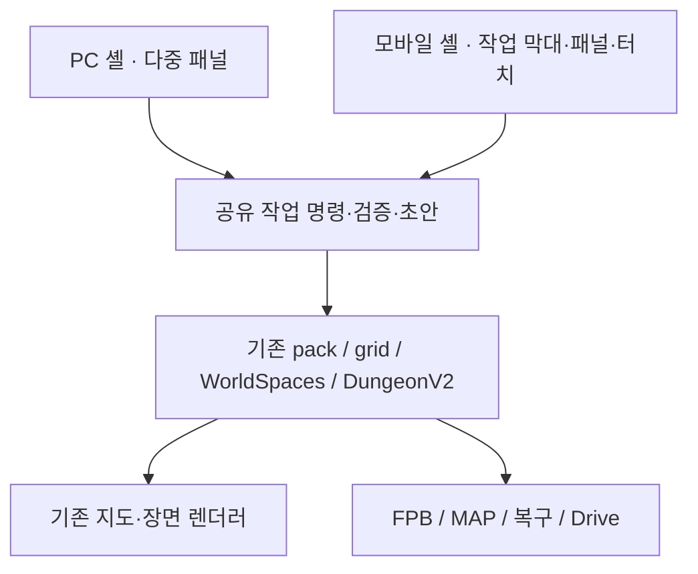

# 모바일 전용 작업실 v1 기획

상태: **검토용 설계·클릭형 시안. 실제 앱 UI에는 미적용.** 기준 커밋: `579373af8ca75fffe175dc4bf48512912cb37b44`, 2026-10-30.

사용자가 정한 작업 우선순위는 **① 세계 생성·지도 편집 → ② 지도 탐색·설정 확인 → ③ GM 세션·던전 조작**이다. PC의 다중 패널 작업실은 유지하고, 모바일에는 생성 단계·터치 편집·선택 패널을 중심으로 별도 화면 구조를 제공한다. 세계 데이터·생성 규칙·검증·저장은 공유한다.

## 검토 자료와 현재 문제

- [현재 모바일 점검 기록](../04-report/mobile-responsive-review-2026-10-30.md): 13개 CSS 화면 크기의 Chromium 터치 에뮬레이션. 넘침·화면 맞춤·초안 유지는 보완됐지만 실제 기기 사용성 검증은 별도다.
- [현재 320px 화면](../04-report/assets/mobile-responsive-review/english-320.png): 상단 두 줄과 하단 공간 전환 메뉴, 화면 맞춤 버튼이 동시에 노출된다. 지도에 작은 지명과 큰 표식이 겹친다. 가로 넘침이 없어도 작업 발견과 지도 판독은 어렵다.
- [현재 가로 던전](../04-report/assets/mobile-responsive-review/dungeon-landscape.png): 제목·옵션·상태·탭·확대 줄이 지도보다 먼저 배치된다. 폭에 맞춰 줄바꿈하는 구조라 화면 높이가 짧으면 지도를 읽을 공간이 부족하다.
- 구현 확인: `planet-builder.ts`의 공통 헤더, `world-spaces.ts`의 탭형 도구 패널, `dungeon-v2.ts`의 공통 편집창, `map-navigation.ts`의 확대·화면 맞춤.
- 기존 [세계·NPC PC 설계](./world-workspace-ui.md)에 승인 Figma 링크가 기록돼 있다. 이번 대화에는 Figma 도구가 없어 해당 파일 내부를 다시 열거나 수정하지 않았다. PC 설계를 모바일 전체 구조에 그대로 축소 적용하지 않는다.

| 문제 | 사용자에게 미치는 영향 | 제안 |
| --- | --- | --- |
| 자주 쓰는 생성·편집과 보조 작업이 같은 상단 줄에 나열됨 | 가로 스크롤 뒤에 기능이 숨고 아이콘 뜻을 추측해야 함 | 지도·편집·생성·세계의 네 가지 작업으로 정리 |
| 지상·수중·지저·3D가 항상 하단을 점유 | 주요 편집 작업이 엄지 영역에서 밀려남 | 현재 공간 이름을 지도 상단 칩으로 표시하고 선택 패널에서 전환 |
| PC용 긴 폼과 작은 지도 선택점 | 대상을 가리거나 이동과 편집을 혼동 | 터치 편집 모드, 선택 목록, 배치 커서·미세 이동 |
| 많은 지명·큰 에셋·배지가 같은 축척에 노출 | 중요한 위치와 소속을 읽기 어려움 | 축척별 표시 밀도와 선택 강조, 전체 목록 접근 |
| 던전의 생성·보기·GM·출력이 한 도구줄에 혼재 | 당장 필요한 동작과 상태를 찾기 어려움 | 던전 진입 후 층·선택·편집·진행을 상황에 따라 제공 |

위 표는 화면과 코드에 근거한 사용성 검토다. 사용자 과제 수행 시간이나 실기기 프레임 속도를 측정한 결과는 아니다.

## 시안 확인

[클릭형 시안](./assets/mobile-interface-v1/prototype.html) · [생성](./assets/mobile-interface-v1/generation.png) · [편집](./assets/mobile-interface-v1/editor.png) · [탐색](./assets/mobile-interface-v1/explore.png) · [가로 화면](./assets/mobile-interface-v1/landscape.png) · [던전](./assets/mobile-interface-v1/dungeon.png)

시안은 생성 단계, 편집 초안, 공간·상세 패널, 던전 흐름을 설명한다. **실제 생성·지도 변경·파일 저장·Drive 연결·정밀 지도 이동은 실행하지 않는다.** 지도 배경은 로컬 앱에서 별도 캡처한 샘플이고 지명·좌표·인구·장치 상태는 설명용이다. 해저·지저 선택은 색조 예시이며 해당 지형의 실제 생성 결과가 아니다.

저장소에서 `python -m http.server 4174 --bind 127.0.0.1 --directory docs/02-design` 실행 후 `http://127.0.0.1:4174/assets/mobile-interface-v1/prototype.html`을 연다. 또는 에셋 폴더 전체를 내려받아 `prototype.html`을 브라우저로 연다. 별도 정적 미리보기이며 앱 개발 서버의 라우트가 아니다. 재생성: `node docs/02-design/assets/mobile-interface-v1/prototype.ts` (Node 24). 앱 번들에서는 이 파일을 참조하지 않는다.

## 화면 구조

### 휴대폰 세로

```text
┌────────────────────────────────────┐
│ 테라온 ▾         검색        저장   │ ← 프로젝트·저장 상태 / 56~64px
│ 변경 있음 · 파일 저장 필요          │
├────────────────────────────────────┤
│ [지상 ▾]                   [표시]   │ ← 공간·레이어
│                                    │
│             지도                   │
│        • 도시/대상                  │
│                               ＋   │
│                               －   │
│                               맞춤 │
│ ┌────────────────────────────────┐ │
│ │ 선택한 대상 / 편집 / 생성 패널  │ │ ← 필요할 때만 열림
│ └────────────────────────────────┘ │
├────────────────────────────────────┤
│   지도      편집      생성      세계 │ ← 아이콘 + 짧은 이름 / 64px
└────────────────────────────────────┘
```

- 상단은 긴 제품 로고·버전·언어를 반복하지 않고 현재 프로젝트 이름과 상태를 우선한다. 언어·앱 정보·복구는 프로젝트 메뉴에 둔다.
- **저장 버튼과 현재 상태는 항상 접근 가능**해야 한다. 로컬 복구, 파일 다운로드, Drive 업로드를 같은 “저장 완료”로 취급하지 않는다. 예: `변경 있음`, `로컬 복구 14:32`, `파일 저장 14:30`, `Drive 업로드 실패`.
- 지도: 탐색으로 복귀. 편집: 지형·개체·이름·속성 도구. 생성: 새 세계·전투지도·던전. 세계: 장소·세력·교단·NPC 목록과 검색. 하단은 서로 다른 화면으로 무작정 이동시키는 링크가 아니라 현재 작업 맥락을 유지하는 작업 진입점이다.
- 빈 프로젝트의 첫 화면은 `새 세계 만들기`와 `기존 파일 열기`를 제공한다. 기존 프로젝트는 마지막 지도 위치를 복원하고 생성 작업을 즉시 찾을 수 있게 한다.
- 아래쪽 패널은 요약/중간/전체의 높이를 갖는다. 드래그 손잡이 외에도 `크게 보기/접기` 버튼으로 같은 동작을 제공한다. 긴 폼은 전체 높이 한 열로 표시한다.
- 패널을 열어도 현재 지도 위치와 선택을 유지한다. 선택점이 패널에 가리면 가용 영역 안으로 화면만 이동한다. 저장 좌표는 바꾸지 않는다.

### 가로·태블릿·PC

| 작업 공간 | 초기 제안 | 정보 패널 | 주의점 |
| --- | --- | --- | --- |
| 휴대폰 세로 / 폭 320~599 CSS px | 상단 56~64px + 하단 작업 막대 64px | 하단 요약·중간·전체 | 시스템 안전 영역은 별도 추가 |
| 휴대폰 가로 / 가용 높이 500px 이하 | 상단 48~56px + 왼쪽 작업 막대 64~68px | 오른쪽 280~320px, 기본 닫힘 | 패널 옆 지도 폭 320px 미만이면 패널 전체 화면 + 명시적 지도 복귀 |
| 태블릿 / 폭 600~1099px | 지도 + 필요할 때만 하나의 상세 패널 | 가용 지도 폭 400px 이상이면 오른쪽 320~360px, 아니면 하단 | 3열을 자동으로 강제하지 않음 |
| 큰 터치 화면 / 폭 1100px 이상 | 터치 작업실 확장형 | 지도 + 상세 1개 | 마우스 연결만으로 화면 구조를 갑자기 바꾸지 않음 |
| PC / 충분한 폭 + 정밀 포인터 | 기존 PC 작업실 | 목록·지도·속성 동시 사용 | 마우스·키보드·단축키 유지 |

위 값은 초기 레이아웃 기준이며 기기 모델 판정이 아니다. **가용 높이, 지도 최소 폭, 입력 방식, 사용자 설정을 함께 사용**한다. 설정에 `자동 / 모바일 / PC`를 제공한다. 수동 선택은 유지하고, 자동 모드도 편집 중에는 입력 기기 변화만으로 셸을 바꾸지 않는다.

회전·주소창·키보드로 크기가 바뀌어도 프로젝트, 지도 중심·배율, 공간, 선택 ID, 던전 층, 미적용 폼을 유지한다. 키보드가 열린 동안에는 입력 폼과 적용 버튼을 가시 영역에 두고 비필수 작업 막대를 접는다. 뒤로 가기는 `패널 단계 → 작업 종료 → 세계 지도` 순으로 처리하며 미적용 변경을 조용히 버리지 않는다.

## 우선 과제 1: 세계 생성


- 기본 생성은 새 프로젝트로 연다. 기존 세계 교체·일부 재생성은 별도 경로로 구분하고 변경 대상·연결 데이터 영향·복구 지점을 보여준다.
- 첫 단계는 세계/전투지도·조감도/다층 던전. 수중·지저는 세계 설정과 연결하며 **터널형·공동 세계형 지저** 선택을 유지한다. 생성 후 공간 전환과 생성 옵션 변경을 구분한다.
- 두 번째 단계는 자주 쓰는 설정만 먼저 표시한다. 시드·기후·세부 생성 옵션은 펼쳐서 접근하되 기능을 삭제하지 않는다. 이전 단계 복귀에도 값을 유지한다.
- 마지막 단계는 결과와 설정 요약, 기존 세계에 미칠 영향을 함께 보여준다. 생성 중 단계 상태와 입력 보존을 제공한다. 실제 중단이 가능한 연산만 취소 가능으로 표시한다.
- 미리보기와 원본을 별도 상태로 보관할 수 없는 기존 생성 경로는 먼저 서비스 경계를 보완한다. 적용 전 원본 보존은 UI 문구만으로 구현됐다고 간주하지 않는다.

### 전투지도 크기와 출력

| 설정 | 기본 칸 수 | 비고 |
| --- | --- | --- |
| 소형 | 25 × 14 | 약 16:9, 사용자 기준 전력 질주 약 2턴 / 일반 이동 약 4턴 |
| 중형 | 48 × 27 | 16:9, 약 4턴 / 8턴 |
| 대형 | 72 × 41 | 약 16:9, 약 6턴 / 12턴, 더 크게 입력 가능 |
| 직접 입력 | 가로·세로 독립 입력 | 현행 8~256칸 범위 유지. 범위 확대는 별도 성능 검토 |

- 칸 수가 정수라 25×14, 72×41은 16:9의 근사치다. 비율 잠금/해제와 가로 기준 세로 반올림을 명시한다. 강제로 저장값을 다시 계산하지 않는다.
- 이동 턴은 사용자가 제시한 계획 기준으로 표시하며 특정 TRPG의 이동 속도·대각선·달리기 규칙을 강제하지 않는다.
- 개별 에셋은 기존 제작 해상도의 **2/3**를 유지한다. 완성 PNG는 가로·세로 중 **긴 변 최대 3000px**다. 화면을 확대해도 격자 수와 PNG 상한은 변하지 않는다.
- 72칸보다 큰 대형도 같은 규칙을 사용한다. 예상 출력 크기와 칸당 픽셀 수를 보여줘 낮아질 판독성을 미리 확인하게 한다.

## 우선 과제 1: 지도 편집

편집을 시작하면 하단 작업 막대가 `취소 · 되돌리기 · 설정 · 적용`으로 바뀐다. 현재 도구·편집 대상·초안 상태를 표시하고 탐색 제스처가 지도 변경을 일으키지 않게 한다.

| 입력 | 지도 탐색 | 지형 칠하기 | 개체 배치·이동 |
| --- | --- | --- | --- |
| 한 번 탭 | 대상 선택, 겹치면 목록 | 브러시 위치/영역 미리보기 | 배치 위치 지정 |
| 한 손가락 드래그 | 지도 이동 | 명시적 `칠하기 / 지도 이동` 전환. 기본은 이동 | 지도 이동 또는 선택한 커서 이동만 수행 |
| 두 손가락 | 확대·축소·이동 | 같은 탐색 동작, 지형 변경 없음 | 같은 탐색 동작, 개체 변경 없음 |
| 미세 조정 | 확대 버튼·맞춤 | 반경 입력, 확대 후 수정 | 상·하·좌·우 한 칸 / 좌표 입력 / 격자 맞춤 |
| 길게 누르기 | 선택 메뉴 보조 | 필수 동작 아님 | 필수 동작 아님 |

- **배치 커서**: 에셋의 점유 영역·회전·충돌 여부를 손가락 위쪽의 확대 미리보기 또는 중앙 커서에 표시한다. 건물·성벽·우물·축사·바닥 타일 등 기존 개별 이미지 에셋을 조립하는 방식을 유지한다.
- 브러시 조작은 도구의 `칠하기` 상태를 명확히 표시한다. `지도 이동`을 한 손가락 대안으로 제공해 두 손가락 조작을 필수로 만들지 않는다. 포인터 취소·영역 밖 드래그·손바닥 입력에서 잘못된 선을 연결하지 않는다.
- 초안은 기존 EditorDrafts/검증 경로에 연결한다. 패널을 접거나 회전해도 유지하며 적용 시 검증된 변경만 커밋한다. 취소는 해당 작업 초안만 버린다. 다른 개체 초안·저장본을 지우지 않는다.
- 이름·속성은 읽기 전용 요약 → 한 열 폼 → 미리보기/적용. 작은 대상을 정확히 누르기 어려우면 세계 목록의 이름 검색으로 같은 편집기에 진입한다.
- 광역 재생성·층 삭제·관계 재계산처럼 다른 데이터에 영향을 주는 작업만 영향 안내와 복구 경로를 추가한다. 단순 패널 열기·표시 변경에 확인창을 반복하지 않는다.
- 일반화된 전역 실행 취소를 새로 약속하지 않는다. 기존 도구별 실행 취소와 초안 적용 범위를 조사하고, 지원 범위를 버튼 상태·설명에 드러낸다.

## 우선 과제 2: 탐색·설정과 시인성

- 축소 지도는 지형·국경·주요 도시 중심, 지역 확대에서는 장소·총본산 배지, 더 확대하면 상세 이름과 자원을 표시한다. 기존 레이어 토글과 `간단히 / 자세히 / 직접 설정`을 제공한다. 자동 숨김 항목도 목록과 검색으로 찾을 수 있다.
- **오브젝트와 총본산 좌표를 이동시키지 않는다.** 같은 소재지의 배지·개수와 선택 목록은 기존 [소재지 고정 정책](./anchored-map-objects.md), [총본산 정책](./headquarters-display-options.md)을 따른다. 서로 다른 좌표를 가까워 보인다는 이유로 같은 장소로 합치지 않는다.
- 상세에는 전체 이름·분류·소재 도시·국가·지도 공간을 함께 표시한다. 지상 총본산과 실제 수중 도시를 혼동하지 않게 공간을 명시한다. 지명 강제 압축·긴 연결선·호버 전용 설명을 사용하지 않는다.
- 세계 목록은 장소·세력·교단·NPC를 검색하고 필터링한다. 국가 → 지역 → 도시 범위는 단계적으로 선택하며 폰에서는 목록/상세 하나만 주 화면으로 보여준다.
- 보기 밀도·레이어를 바꾸는 동작과 원본 지도 데이터 편집을 구분한다. 보기 설정만 바꿔 세계를 재생성하거나 저장된 고도를 변경하지 않는다.

### 글자·버튼·상태 기준

| 항목 | 제안 기준 |
| --- | --- |
| 주요 터치 영역 | 기본 48×48 CSS px, 최소 44×44px. 인접 독립 동작 간 8px 여유 권장 |
| 본문·입력 | 본문·폼 16px, 보조 본문 14px. 12px는 비핵심 메타 정보에만 사용 |
| 제목 | 18~22px. 제어 요소는 읽기 쉬운 한글 산세리프, 장식 글꼴은 짧은 제목에 한정 |
| 대비 | 일반 글자 4.5:1, 큰 글자·필수 UI 경계·아이콘 3:1 목표. 실제 배경 합성 상태에서 측정 |
| 지도 위 텍스트 | 지형에 묻히지 않는 불투명 패널/짧은 라벨 사용. 글자 폭을 강제로 줄이지 않음 |
| 아이콘 | 아이콘 + 짧은 이름. 단독 아이콘은 검색·닫기·확대 등 익숙한 동작에 한정하고 접근성 이름 제공 |
| 상태 | 색 + 텍스트/모양. 선택·비활성·잠금·초안·오류를 색으로만 구분하지 않음 |
| 글자 확대 | 시스템 글자 확대와 브라우저 200% 확대에서 버튼·폼을 잘라 숨기지 않음 |
| 접근성 | VoiceOver/TalkBack, 포커스 복귀, 뒤로 가기, 키보드 대안, 모션 감소. 패널 확대는 드래그 외 버튼 제공 |

지도 내부의 핀은 실제 위치를 유지한다. 선택 후보의 터치 영역이 겹치면 가장 위 개체를 임의로 선택하지 않고 후보 목록을 연다. 48px 터치 영역을 확보하려고 핀 그림 자체를 전부 48px로 키우지 않는다.

## 우선 과제 3: 던전 작업실

- 진입 후 같은 셸에서 전체 지도를 우선 표시하고 세계 지도 복귀를 제공한다. 층 선택은 `1층 ▾`, 지도 종류·격자·조감도는 `표시`, 구조 변경은 `층 관리`로 묶는다.
- 방/장치를 선택하면 요약 패널과 해당 대상의 유효한 조작만 보여준다. 작은 이미지 외에도 방별 부품 목록으로 선택할 수 있다.
- GM 진행은 명시적인 진행 패널에 둔다. 라운드·장치 변경은 현재 값과 결과를 확인한 후 적용하며, 잘못 누른 경우 기존 되돌리기 범위를 제공한다.
- 플레이어 보기는 항상 눈에 보이는 상태로 표시한다. **현재 제공 범위는 플레이어 미리보기·출력이며, 다중 사용자 권한 시스템을 구현했다고 표현하지 않는다.** GM 비밀 장치·노트는 플레이어 표시용 데이터와 출력에서 제거해야 하며 CSS 숨김에 의존하지 않는다.
- 다층 생성·추가·복제·재생성은 같은 단계형 폼을 사용하고 기존 층·연결·잠금 영향 요약을 제공한다. 던전 v2 도메인과 기존 에셋을 유지한다.

## PC·모바일의 구현 경계



아래는 **신규 구현 제안 위치**이며 현재 존재하는 모듈이라고 주장하지 않는다.

| 제안 위치 | 책임 |
| --- | --- |
| `src/services/workspace-layout.ts` | 가용 영역·사용자 선호·셸 전환. 도메인 상태를 소유하지 않음 |
| `src/controllers/mobile-workspace.ts` | 네 작업 진입점·선택·패널·뒤로 가기 |
| `src/controllers/mobile-generation.ts` | 단계형 폼과 임시 입력, 공유 생성 경로 연결 |
| `src/controllers/mobile-map-editor.ts` | 터치 의도·커서·브러시 입력을 기존 편집 동작으로 전달 |
| `src/types/workspace.ts` | 선택·보기·편집 모드의 UI 상태. 세계 저장 스키마와 분리 |

- 기존 화면 버튼을 숨긴 채 `.click()`으로 대리 호출하는 방식에 모바일 전체를 의존시키지 않는다. 생성·편집 진입 함수를 조금씩 추출해 두 셸에서 공유한다. 이 단계에서 `src/index.html`을 한 번에 재작성하지 않는다.
- `pack`·`grid`·저장 구조는 분기하지 않는다. 셸별 이벤트 리스너는 마운트/해제 시 중복되지 않게 관리한다. 렌더러가 임의의 도시·총본산 좌표를 바꾸지 않는다.
- 표시용 UI 상태는 프로젝트/개체 ID와 함께 저장해 다른 프로젝트의 초안·층 선택을 섞지 않는다. 보기 전환만으로 `project:changed`를 발생시키지 않는다.
- 두 셸은 같은 프로젝트를 읽는다. UI 개편을 이유로 PNG 상한, 생성 시드·기후, TRPG 판본/출처, 기존 수중·지저 모델을 바꾸지 않는다. 새 런타임 의존성은 추가하지 않는 방향이다.

## 구현 순서와 완료 조건

| 단계 | 범위 | 완료 조건 |
| --- | --- | --- |
| 1. 모바일 셸·저장·선택 | 네 작업, 공간/표시 패널, 프로젝트·저장 상태, 검색·요약, 회전 | 현재 위치·폼·저장 상태 보존. PC 기능 회귀 없음 |
| 2. 생성 전용 화면 | 세계·전투지도·다층 던전 단계형 생성, 상세 설정·미리보기 | 설정 왕복 유지, 원본 보존, 크기/3000px 규칙 유지 |
| 3. 모바일 편집 | 지형 브러시, 장소 배치·이동·이름·속성, 미세 조정 | 탐색 중 데이터 변경 없음, 적용/취소·초안·검증 동작 |
| 4. 탐색·정보 밀도 | 축척별 표시·겹침 후보·세계 목록·설정 확인 | 좌표 불변, 모든 개체에 목록 접근, 한·영 긴 이름 판독 |
| 5. 던전 진행 | 층 관리·장치·라운드·플레이어 미리보기·출력 | GM 정보 제거, 다층 연결·잠금·진행 상태 보존 |

단계 1만으로 모바일 개편이 완료됐다고 보고하지 않는다. **사용자 우선순위의 핵심 납품 범위는 단계 1~3**이다. 레거시의 모든 편집기를 한 번에 이전하지 않고 도구별 지원 현황을 남긴다. 미이전 고급 편집을 무작정 PC 크기 창으로 열지 않으며, 기능 목록과 후속 이전 대상을 명시한다.

성능은 셸 분리만으로 해결됐다고 판단하지 않는다. 지도 이동 중 전체 패널/목록 재생성을 막고, 프레임 단위 갱신·제스처 종료 후 라벨 조정·보이는 에셋 우선 로딩을 유지한다. 대용량 세계/던전의 실제 기기 성능을 별도로 측정하고 저밀도 표시 옵션을 제공한다.

## 검수 계획

| 구분 | 검수 내용 |
| --- | --- |
| 과제 A · 생성 | 세계 생성 → 설정 왕복 → 미리보기 → 적용. 소/중/대/직접 입력, 16:9 해제, 72칸 초과, 긴 변 3000px |
| 과제 B · 편집 | 도시 검색 → 배치/이동 → 회전·확대 → 미세 조정 → 적용/취소. 지형 이동 모드에서 고도 불변 |
| 과제 C · 탐색 | 겹친 도시/교단 선택 → 전체 이름·소재지 → 수중/지저 전환 → 설정 확인 → 원래 위치 복귀 |
| 과제 D · 던전 | 층 선택·장치 발동 → 라운드 → 미리보기/출력. 플레이어 출력에 GM 비밀 정보 없음 |
| 화면 | 320×568, 390×844, 568×320, 844×390, 768×1024, 1024×768, 820×1180, 1180×820, PC 1440×900 |
| 실기기 | Android Chrome / iPhone Safari / iPad Safari. 주소창·노치·홈 영역·키보드·화면 회전·스크롤 경합 |
| 접근성 | 한·영, 긴 이름, 200% 확대, 보이스오버/톡백, 색각·대비·포커스·드래그 대안 |
| 데이터 | 보기·회전 전후 세계/던전 JSON 불변, 저장 후 재로드 동일, 초안 유지, PC에서 같은 파일 열기 |
| 성능 | 기준 기기·지도 셀 수·표식 수·층/에셋 수를 명시해 입력 반응·제스처 프레임·메모리 측정 |

목표는 일반 작업이 아이콘 추측·가로 메뉴 탐색·정밀 드래그 없이 끝나는 것이다. 실제 사용성 검토에서는 생성, 도시 한 곳 수정, 겹친 장소 선택의 세 과제에서 오조작·복귀 실패·미적용 값 유실을 기록한다. 이 문서는 해당 실기기·사용자 검수를 완료했다는 보고가 아니다.

## Figma 인계 명세

현재 대화에서 Figma 파일 생성·수정은 수행하지 않았다. 기존 PC Figma를 보존하고 아래 구성으로 모바일 페이지를 추가하는 안이다.

- 페이지: `Mobile / 01 Flows`, `02 Components`, `03 Screens`, `04 States & A11y`.
- 프레임: 휴대폰 390×844와 320×568, 가로 844×390, 태블릿 820×1180. 가용 영역과 안전 영역을 별도 가이드로 표시한다.
- 우선 화면: 빈 프로젝트, 지도 기본, 생성 대상, 컨셉, 크기·기후, 미리보기, 편집 도구, 배치/브러시, 속성 폼, 겹침 후보, 세계 목록, 저장·복구 상태. 던전·장치·층·플레이어는 후속 흐름.
- 컴포넌트: ProjectHeader, TaskBar, SpaceChip, LayerSheet, SelectionSheet, EditorDock, PlacementCursor, GenerationStepper, WorldList, SaveStatus, FloorPicker.
- 변수: 화면 폭/높이, 배경·표면·글자·테두리·강조·위험 색, 4/8/12/16/24 간격, 48px 터치, 16px 입력, 패널 높이·폭. PC 테마의 차콜·금색·에메랄드 계열을 공유한다.
- 변형: 기본/선택/잠금/비활성/초안/실패/로딩, 요약/중간/전체 패널, 세로/가로, 편집/탐색, GM/플레이어.
- 연결: 생성 3단계 왕복, 대상 선택과 목록 복귀, 편집 적용/취소, 회전 시 맥락 유지, 저장 실패·복구, 층 전환. 시안의 샘플 데이터는 실제 프로젝트에 추가하지 않는다.

클릭형 시안은 일부 흐름을 설명하는 도구이며 전체 컴포넌트 변형·브러시 제스처·실제 데이터 바인딩·생성 초안 보존·접근성 검수를 대체하지 않는다.

## 이번 기획 산출물 점검

앱 구현과 별도로 클릭형 시안에서 390×844, 320×568, 844×390, 820×1040 프레임의 헤더 넘침과 패널 경계를 확인했다. 생성 프리셋·직접 비율 조정·단계 복귀 시 입력 유지, 편집 커서·적용 상태, 총본산 상세, 던전 층·플레이어 미리보기 전환을 점검했고 브라우저 스크립트 오류는 없었다. [시안 점검 수치](./assets/mobile-interface-v1/review.json). 생성기 TypeScript 단독 검사와 설계서 상대 링크 확인을 통과했다.

이 점검은 실제 모바일 앱의 조작성·생성 성능·저장 무결성 검수를 대신하지 않는다. 앱 소스·의존성·세계 데이터는 수정하지 않았으며 실제 앱 빌드나 공개사이트 배포를 수행한 작업이 아니다.
